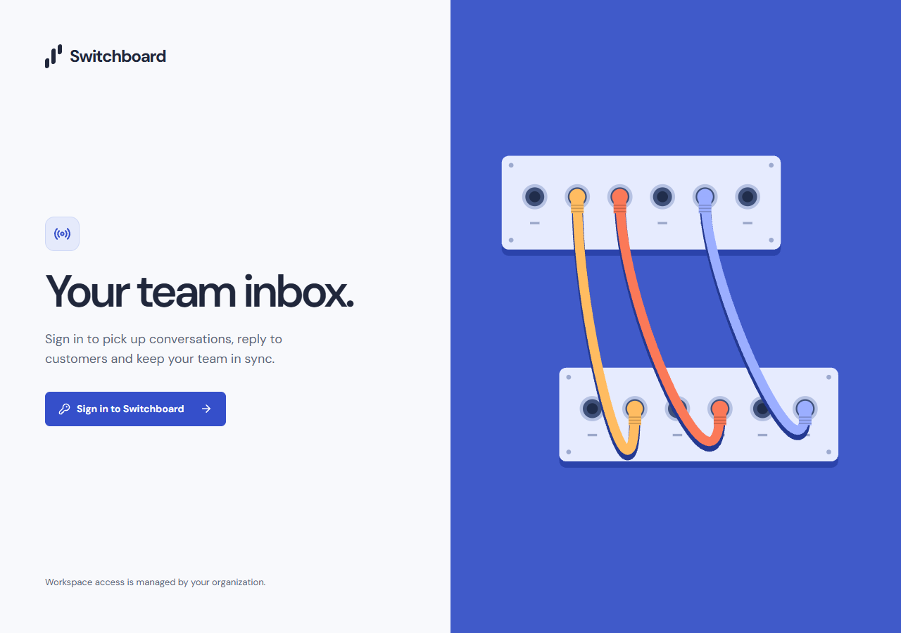
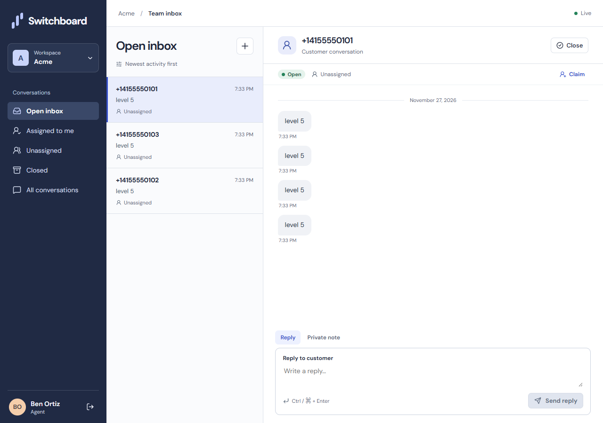
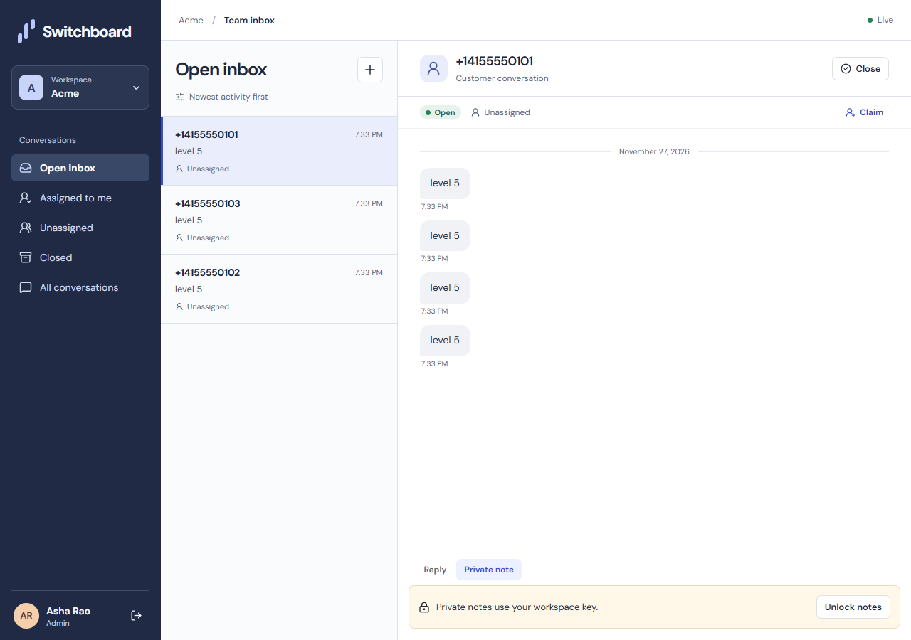
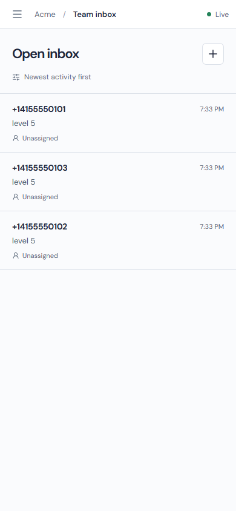
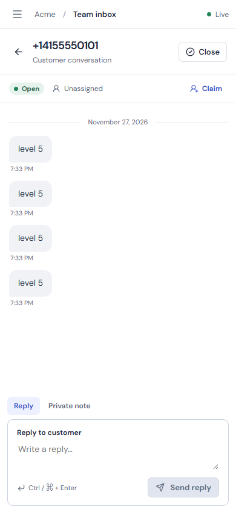

# Switchboard

Switchboard is a multi-tenant shared customer-support inbox. Human support agents sign in through an identity provider, claim conversations, reply through the Pigeon messaging carrier, track delivery status and leave end-to-end encrypted private notes for their teammates. MongoDB persists every inbox event. Redis coordinates sessions, rate-limit state and outbox leases across server instances.

## Screenshots

### Login


### Team inbox — desktop


### Active conversation


### Private encrypted notes


### Mobile responsive view
 

## Features

- **OIDC sign-in** — authorization code + PKCE (S256) with JWKS token verification; nonce and state replay protection; session stored in Redis; Secure cookie when deployed over HTTPS.
- **Multi-tenant isolation** — every read and write is scoped to a verified workspace membership; `403` for cross-workspace attempts, `401` without a session.
- **Real-time inbox** — WebSocket delivers events with monotonic `seq`; replay after disconnect (supply `?after=N`); cross-instance delivery via shared MongoDB poll; session re-validated on each loop.
- **Webhook ingestion** — HMAC-SHA256 raw-body verification; timestamp within ±5 minutes; `401` for bad signatures, `400` for unparseable bodies, `2xx` for unknown workspaces or event types; deduplication on event ID and message ID.
- **Durable outbox** — reply is committed to MongoDB before the `202` is sent; shared Redis bucket (capacity 8, 4 tokens/second per workspace) prevents 429s across instances; 10-second recoverable lease ensures another worker resumes if the original process dies; exponential back-off; stable idempotency key across all retries.
- **Atomic conversation claims** — unique key per contact; concurrent claimants: one wins, the rest get `409`; the holder retrying gets `200`.
- **End-to-end encrypted notes** — workspace key never leaves the browser; AES-256-GCM with per-note IV and additional authenticated data binding the ciphertext to workspace, contact, author and note ID; fingerprint registered once per workspace, conflict on mismatch; server stores only ciphertext, IV and metadata.
- **Responsive UI** — single-column mobile layout and two-pane desktop layout; keyboard shortcuts; loading, empty, error and success states throughout.

## Checker results

| Level | Situation | Score |
|-------|-----------|-------|
| 1 | One instance, bad network, forged webhooks, concurrent claims | **24 / 24** |
| 2 | Killed without warning and restarted mid-flood and mid-send | **14 / 14** |
| 3 | Multiple instances, shared rate limit, 60-second failover | **22 / 22** |
| 4 | Written contract rules (organiser-only run) | pending |
| 5 | Login, tenant isolation, real-time WebSocket | **15 / 15** |
| **Total** | | **75 / 75** |

Level 2 was verified from a Linux-native checkout inside Docker to avoid Windows bind-mount startup latency that caused an initial `12.9/14`.

## Technology stack

| Layer | Choice |
|-------|--------|
| Runtime | Node.js 22, TypeScript, ES modules |
| Server | Express 5, ws (WebSocket) |
| Persistence | MongoDB 7 (journaled writes, unique compound indexes) |
| Coordination | Redis (Lua atomic scripts for rate-limit bucket and lease) |
| Auth | jose (JWKS, JWT RS256), OIDC authorization code + PKCE |
| Frontend | React 19, Vite 8, Lucide icons, DM Sans (variable font) |
| Crypto | Web Crypto API (AES-256-GCM, SHA-256) |

## Run from a clean clone

Requires Node.js 22.13 or newer in the 22.x line, npm, and Docker with Compose. Run all commands from the repository root.

```sh
npm run up              # start MongoDB, Redis and simulators in Docker
npm run scaffold:install
```

The install command uses both lockfiles and builds the server and web app. Start these in separate terminals:

```sh
npm run scaffold:server   # API server on http://localhost:4000
npm run scaffold:web      # Vite dev server on http://localhost:5173
```

Open **http://localhost:5173** and click **Sign in to Switchboard**. The mock identity provider lists five test users — no passwords needed.

| User | Workspace | Role |
|------|-----------|------|
| Asha Rao | Acme | admin |
| Ben Ortiz | Acme | agent |
| Chloe Martin | Globex | admin |
| Dev Patel | Globex | agent |
| Eli Novak | Acme + Globex | agent |

To trigger an inbound message immediately: `npm run inbound`. After a checker run, resume the drizzle traffic: `npm run drizzle`.

For a single-process demo set `WEB_ORIGIN=http://localhost:4000` in a root `.env` and run `npm run start:server`. Open **http://localhost:4000** — Express serves the built React assets.

## Configuration

`.env.example` in the repository root contains the simulator defaults. Local runs load them automatically; environment variables take precedence. With `NODE_ENV=production` supply all values explicitly:

| Variable | Description |
|----------|-------------|
| `PORT` | Server port |
| `WEB_ORIGIN` | Browser origin for CORS and CSP |
| `MONGO_URL` | MongoDB connection string |
| `REDIS_URL` | Redis connection string |
| `PIGEON_URL` | Pigeon base URL |
| `PIGEON_WEBHOOK_SECRET` | HMAC-SHA256 signing secret |
| `PIGEON_KEY_WS_ACME` | Pigeon API key for ws_acme |
| `PIGEON_KEY_WS_GLOBEX` | Pigeon API key for ws_globex |
| `OIDC_ISSUER` | IdP issuer URL |
| `OIDC_CLIENT_ID` | Registered client ID |
| `OIDC_CLIENT_SECRET` | Client secret |
| `OIDC_REDIRECT_URI` | Callback URL |
| `GRADER_TOKEN` | Shared secret for grader endpoints |

Use a dedicated MongoDB database per deployment. All instances must point at the same database, Redis service and OIDC configuration.

## Verify

Stop the app server before running the official checker — it starts its own instances and resets the inbox.

```sh
npm run doctor
npm --prefix scaffold/server test          # unit + integration tests
npm --prefix scaffold/web run typecheck    # TypeScript
npm run check                              # level 1 (~90 s)
npm run check -- --levels 5               # level 5 only
npm run check:full                         # levels 1, 2, 3, 5 (~4 min) → CHECK_REPORT.json
```

**Windows note:** run `npm run check:full` from a Linux-native checkout inside Docker or WSL to avoid bind-mount startup latency that affects the level 2 crash recovery timing.

The regression tests use an isolated, randomly named MongoDB database and cover raw-body signature verification, timestamp boundary enforcement, unknown event types, provider retry headers and concurrent inbox operations (concurrent replies converge to one, concurrent claims produce exactly one winner).

## Reliability mechanisms

- **Exactly-once inbound** — unique index on `(workspace, eventId)` and `(workspace, key)` where key embeds the message ID; duplicate event IDs or message IDs silently coalesce.
- **Stale-status prevention** — `delivered` and `failed` are terminal; a later `sent` event is discarded; out-of-order delivery (delivered before sent) is handled correctly.
- **Outbox durability** — the queued-reply document is both the user record and the work item; a process dying between writes is recovered within 10 seconds by another worker.
- **Rate-limit coordination** — a Redis Lua script atomically checks the bucket and sets a lock in one round-trip; a 429 sets a cooldown key that blocks all workers for that workspace until the retry window passes.
- **WebSocket replay** — `GET /ws?workspace=X&after=N` delivers all frames with `seq > N` before switching to live; works across instances because all read from MongoDB.

## Security

- Webhook signatures verified with `timingSafeEqual` before any JSON parsing.
- Grader token verified with `timingSafeEqual`; `401` without it.
- Session IDs are 32-byte random values; stored key is their SHA-256 digest.
- Login state (nonce, PKCE verifier) is single-use and expires in 300 seconds.
- Workspace membership re-verified on every HTTP request and WebSocket message.
- CSP, `X-Content-Type-Options`, `Referrer-Policy` and `frame-ancestors` on every response.
- Private notes: AES-256-GCM, non-extractable key, additional authenticated data prevents ciphertext reuse across contacts or workspaces.

## Known limitations

- Conversation list aggregates the full event history on each request; long-running tenants would benefit from a materialised projection.
- Thread view fetches all events for a contact; unbounded threads will grow slowly.
- WebSocket pump polls MongoDB every 250 ms; a pub/sub fan-out would reduce latency and load at scale.
- Delivery status depends on Pigeon's idempotency retention; if the final callback is lost and Pigeon provides no lookup API, the last known status stays `sent`.
- Private key is shared among workspace members with no forward secrecy; removing a member does not rotate the key or invalidate previously captured ciphertexts.
- Elasticsearch search and Paybox billing were not implemented; core reliability was prioritised.

## Implementation map

- [`scaffold/server/src/`](scaffold/server/src/) — event store, projections, outbox, auth, WebSocket, grader endpoints
- [`scaffold/web/src/`](scaffold/web/src/) — inbox, reconnecting client, retryable composer, browser-side encryption
- [`DECISIONS.md`](DECISIONS.md) — trade-offs and known faults
- [`PROTOCOL.md`](PROTOCOL.md) — encrypted notes key custody and threat model
- [`CHECK_REPORT.json`](CHECK_REPORT.json) — official checker output
